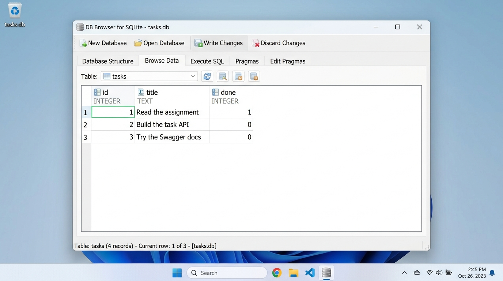

# FlyRank Backend Track - Week 3: Connecting CRUD to SQLite

A persistent FastAPI Task API connecting CRUD operations to a local **SQLite** database (`tasks.db`), ensuring data survives server restarts and crashes.

---

## Why SQLite?

1. **Zero Configuration & Serverless:** Unlike PostgreSQL or MySQL, SQLite requires no daemon, background service, connection pooling, network ports, or credentials. It operates as an embedded in-process library.
2. **Single-File Storage:** The entire database—tables, indices, metadata, and records—lives in a single portable file (`tasks.db`). Backups and resets are as simple as copying or deleting the file.
3. **Full Persistence & ACID Reliability:** Changes are written synchronously to disk using atomic transactions. When the server restarts, crashes, or is deployed elsewhere, all tasks remain intact.
4. **Fast & Lightweight:** With zero network overhead (queries execute directly in memory/disk I/O), SQLite handles thousands of operations per second with minimal memory footprint.

---

## Where the Database Lives

- The database file is located at `tasks.db` in the application working directory.
- **Automatic Initialization:** If `tasks.db` does not exist when the application boots, it is automatically created and seeded with 3 starter tasks.
- **Git Ignored:** `tasks.db` is included in `.gitignore` so every fresh clone starts with a clean database instance.

---

## One Command to Run

Install dependencies and start the API:

```bash
uvicorn main:app --reload --port 8000
```

Interactive Swagger documentation is available at [http://localhost:8000/docs](http://localhost:8000/docs).  
Health check endpoint is available at [http://localhost:8000/health](http://localhost:8000/health).

---

## Database Inspection (DB Browser for SQLite)

Below is `tasks.db` viewed directly in **DB Browser for SQLite**, displaying the schema and the initial seeded tasks:



---

## Stage 4: Example SQL Query Run by Hand

During Stage 4, direct SQL queries were executed against `tasks.db`. An example query:

```sql
SELECT * FROM tasks WHERE done = 1;
```

**Returned Result:**
```
id | title               | done
---+---------------------+-----
1  | Read the assignment | 1
```

**Explanation:** This query filters all rows in the `tasks` table where the `done` column equals `1` (representing `True`). In SQLite, boolean flags are stored as integers (`0` or `1`). Modifying rows via SQL immediately reflects in `GET /tasks` because both DB Browser and FastAPI read from the exact same file without intermediate caching.

---

## API Endpoints

| Method | Path | Description | Success Code |
| :--- | :--- | :--- | :--- |
| **GET** | `/` | API summary and root information | `200 OK` |
| **GET** | `/health` | Server health check (`{"status": "ok"}`) | `200 OK` |
| **GET** | `/tasks` | List all tasks from SQLite with optional filters | `200 OK` |
| **GET** | `/tasks/{id}` | Retrieve a specific task by ID | `200 OK` |
| **POST** | `/tasks` | Create a new task (persisted to SQLite) | `201 Created` |
| **PUT** | `/tasks/{id}` | Update title or completion status | `200 OK` |
| **DELETE**| `/tasks/{id}` | Permanently delete a task | `204 No Content` |
| **GET** | `/stats` | Task statistics computed using SQL `COUNT(*)` | `200 OK` |

---

## Checkpoint Verifications

### 1. Persistence Checkpoint
```bash
# 1. Create a new task
curl -X POST http://localhost:8000/tasks \
  -H "Content-Type: application/json" \
  -d '{"title": "Verify Persistence"}'

# 2. Stop the server (Ctrl+C) and restart it:
# uvicorn main:app --reload --port 8000

# 3. Fetch tasks - your created task is still there!
curl http://localhost:8000/tasks
```

### 2. Error Handling Checkpoint
```bash
# Missing id returns 404
curl -i http://localhost:8000/tasks/999
# HTTP/1.1 404 Not Found
# {"error": "Task not found"}

# Invalid body returns 400
curl -i -X POST http://localhost:8000/tasks \
  -H "Content-Type: application/json" \
  -d '{"title": ""}'
# HTTP/1.1 400 Bad Request
# {"error": "String should have at least 1 character"}
```
