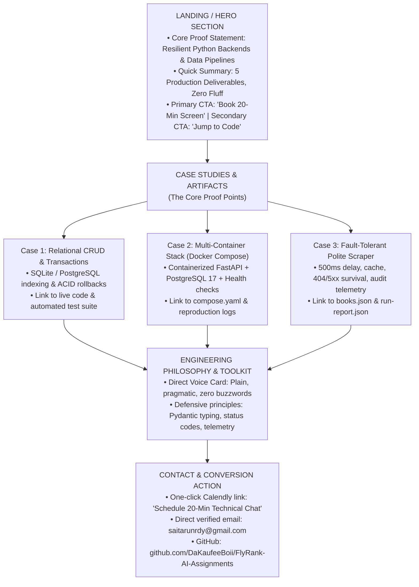

# Assignment 3: Draw the Path: Portfolio Sitemap + Toolkit
**Track:** General AI Fluency  
**Week:** 1 | **Phase:** Setup | **Workload:** 3h  
**Author:** Sai Tarun Reddy (`saitarunrdy@gmail.com`)  
**Deliverable Document:** [deliverable.md](./deliverable.md)

---

## 1. Portfolio Sitemap & Visitor Journey

A portfolio with no claim is decoration. This sitemap walks **one specific person** (a startup engineering lead or CTO) directly from the **initial claim** to the **single conversion action** (booking a 20-minute technical interview), without unnecessary friction or distraction.

### Visual Architecture Diagram (Mermaid)



### Page Structure & Purpose

| Screen / Section | Target Audience Experience | Content & Proof Elements |
|---|---|---|
| **1. Hero / Claim** | *"Is this candidate worth 3 minutes of my time?"* | Named claim: tested Python APIs, database transactions, fault-tolerant pipelines. No abstract taglines. |
| **2. Case Studies (Proof)** | *"Can this person actually write production code?"* | 3 deep dives with measurable results, architecture decisions, and links to GitHub commits. |
| **3. Engineering Standards** | *"What are their defaults and engineering culture?"* | Voice card, testing philosophy, defensive coding principles, error-handling ethos. |
| **4. Contact / Action** | *"Let's talk to this candidate."* | Frictionless booking link (Calendly/Cal.com) and direct email. No cumbersome contact forms. |

---

## 2. Free AI Toolkit Verification

The developer toolkit has been configured for the entire 8-week program:
* **Claude (Anthropic):** Active for architectural reasoning, prompt pressure-testing, and case framing.
* **ChatGPT (OpenAI):** Active for rapid syntax cross-checks and algorithmic comparisons.
* **Google Gemini:** Active for multi-modal analysis, large-context log inspections, and quick verification.
* **Perplexity:** Active for real-time library documentation searches and RFC lookups.

---

## 3. Claude Project Configuration

* **Project Name:** `FlyRank-Portfolio-Architect`
* **Custom Instructions (Standing Prompt):**
```text
You are a senior technical advisor and cynical engineering manager helping Sai Tarun Reddy build a lean, conversion-focused developer portfolio.

Proof Statement:
"I engineer resilient, production-ready Python backend services—specializing in typed FastAPI APIs, transactional database architectures (PostgreSQL/SQLite), and fault-tolerant data pipelines that survive real-world network anomalies. Target: engineering hiring managers at AI/SaaS startups. One Action: Schedule a 20-minute technical interview."

Rules:
1. Every page or section must earn its place against the Proof Statement and the One Action.
2. If a section smells like generic resume filler (e.g., 'Passionate learner', 'Soft skills', 'Interests'), demand its removal.
3. Ensure every case study features three beats: The Problem, What I Did & Decided, What Came of It.
```

---

## 4. Pressure-Test Prompt & AI Critique

### The Pressure-Test Prompt:
> *"Here is my proposed 5-page sitemap: 1. Home / Hero, 2. Projects (5 items), 3. About Me (my background, education, and hobbies), 4. Technical Blog / Insights, 5. Contact Form. Review this against my single conversion action: getting a technical lead to schedule a 20-minute interview. Tell me what is redundant, what distracts from the proof, and what will cause visitors to bounce."*

### The AI Critique Output:
> *"Your 5-page structure is leaking attention everywhere. Here is what fails:
> 1. **The Blog Page is a Liability:** Unless you have 5 deep, original technical essays, an empty or shallow blog screams 'tutorial project'. Cut it.
> 2. **About Me Page is an Exit Ramp:** Technical leads do not care about your hobbies or childhood interest in computers. They care if you can build reliable software. Fold the essential bio (2 sentences) into the hero or footer.
> 3. **The Contact Form Adds Friction:** Senior leads do not want to fill out web forms and wait for an email. Give them a direct email link and a calendar booking link.
> 4. **Multi-page Navigation Dilutes Momentum:** Turn this into a single, high-density, beautifully structured scrollable page where the visitor moves seamlessly from Claim → Proof (Cases) → Philosophy → Calendar."*

---

## 5. What Was Changed Based on the Critique

> [!IMPORTANT]
> **Key Architectural Revision:**  
> I immediately eliminated the separate **"About Me"**, **"Blog"**, and **"Contact Form"** pages. Instead, the portfolio was condensed into a **single-page linear flow**:
> 1. Merged the bio directly into the **Hero section** as a 2-sentence technical background.
> 2. Replaced the generic contact form with a **direct 20-minute Calendly link** and a copy-to-clipboard email button.
> 3. Filtered the project showcase down to the **top 3 high-signal backend case studies** with direct links to reproducible code and tests.

---

## 6. Pass / Revise Verification

- [x] **Lean Sitemap:** Every section earns its place against the proof statement and booking action.
- [x] **Configured Claude Project:** Customized with genuine instructions and standing proof statement.
- [x] **Pressure-Tested:** Real prompt executed against AI thinking partner with rigorous critique saved.
- [x] **Documented Change:** Noted specific structural cuts (removed blog/about pages; switched to high-converting single-page architecture).
