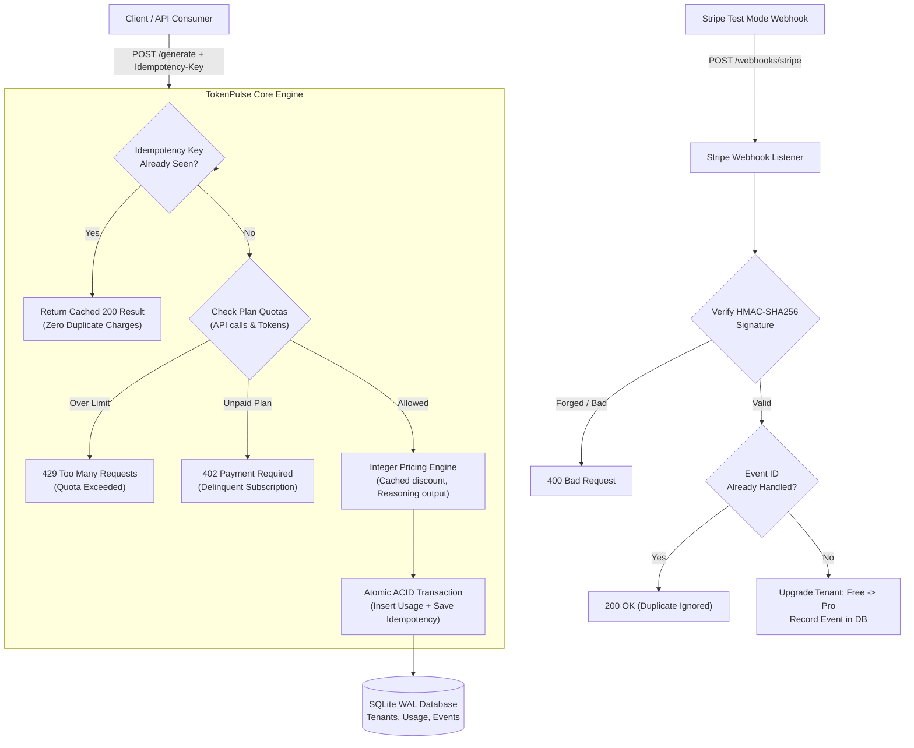

# TokenPulse — LLM Usage Metering & Billing Engine
**FlyRank Internship Backend Capstone Project**  
**Author:** Sai Tarun Reddy (`saitarunrdy@gmail.com`)  
**Stack:** Python 3.10+, FastAPI, SQLite3 (WAL mode), Pydantic v2, Pytest, Stripe Test Mode  

[](./EVIDENCE.md)
[](#integer-money-math)
[](#idempotency-engine)

---

## 1. What the System Does

Every SaaS company running AI features must solve three mission-critical problems:
1. **How much did this customer use?** (Accurately meter API calls and token subtypes).
2. **How much does it cost?** (Calculate fees using complex pricing rules: cached input discounts, reasoning token surcharges).
3. **Have they reached their plan limits?** (Enforce hard quotas with machine-readable `429 Too Many Requests` or `402 Payment Required` responses).

**TokenPulse** is a production-grade backend engine that guarantees **exactly-once metering** under retries, prevents double charges via cryptographic idempotency keys, accurately calculates token costs in integer micro-cents, and synchronizes subscription tiers via signature-verified Stripe webhooks.

---

## 2. Architecture Overview



---

## 3. The 3 Hard Engineering Problems Solved

### A. Exactly-Once Metering (Idempotency Engine)
Network retries are inevitable in distributed systems. If an API client retries a timed-out generation request, TokenPulse inspects the `Idempotency-Key` header. If the key exists, TokenPulse returns the cached response with `idempotency_replay: true` and records **0 new usage events**, guaranteeing no customer is ever double-billed.

### B. Integer Money Math (Zero Floats)
Floating-point math causes catastrophic cumulative rounding errors. TokenPulse represents all costs as **integer micro-cents** (1 USD = 1,000,000 micro-cents).
- **Standard Input:** \$2.50 per 1M tokens (2.5 micro-cents / token).
- **Cached Input:** \$1.25 per 1M tokens (1.25 micro-cents / token) — *50% cheaper*.
- **Standard Output:** \$10.00 per 1M tokens (10.0 micro-cents / token).
- **Reasoning Tokens:** \$10.00 per 1M tokens (10.0 micro-cents / token) — *correctly counted as output*.

### C. Cryptographic Stripe Webhooks & Plan Synchronization
Webhooks arrive out of order and can be replayed. TokenPulse:
1. Cryptographically verifies incoming signatures via `HMAC-SHA256` using the raw payload bytes and timestamp tolerance window.
2. Deduplicates events by tracking processed `event_id`s in a dedicated database table.
3. Automatically transitions tenant status (`Free` → `Pro`) upon receiving `checkout.session.completed`.

---

## 4. Quick Start (Run & Seed in Under 1 Minute)

### 1. Install Dependencies
```bash
cd tokenpulse-billing-engine
pip install -r requirements.txt
```

### 2. Configure Environment Variables
```bash
cp .env.example .env
```

### 3. Initialize & Seed Database
```bash
python seed.py
```
*Seeds default test tenants: `tenant_free_001` (Free tier), `tenant_pro_002` (Pro tier), `tenant_boundary_003` (Quota testing), and `tenant_unpaid_004` (Delinquent status).*

### 4. Run the Engine
```bash
uvicorn app.main:app --reload --port 8000
```
- Interactive Swagger UI: [http://localhost:8000/docs](http://localhost:8000/docs)
- Health Check: [http://localhost:8000/health](http://localhost:8000/health)

---

## 5. Verification & Acceptance Probes

Run the full acceptance probe test suite:
```bash
python -m pytest tests/test_probes.py -v
```

All 5 probes pass cleanly:
1. `test_probe_1_idempotent_metering`: Retried request with identical key creates exactly 1 usage event.
2. `test_probe_2_quota_boundary_and_status_codes`: Boundary returns 200; next returns 429; unpaid returns 402.
3. `test_probe_3_stripe_checkout_and_plan_upgrade_webhook`: Webhook flips Free tenant to Pro and updates quota to 10M tokens.
4. `test_probe_4_webhook_signature_verification_and_replay_deduplication`: Bad signature rejected with 400; duplicate webhook ignored safely.
5. `test_probe_5_pinned_token_pricing_rules`: Accurate integer pricing for input, cached input, output, and reasoning tokens.

Full execution transcripts and database proofs are available in [EVIDENCE.md](./EVIDENCE.md).

---

## 6. Honest Limitations & Non-Goals

- **Invoicing & PDF Generation:** Invoices are summarized via `/usage` JSON endpoints; automated PDF invoice generation is left as a future stretch goal.
- **Mid-Cycle Proration:** Upgrades take effect immediately; dynamic mid-cycle credit proration is not handled in this core build.
- **Distributed In-Memory Cache:** SQLite WAL mode with `BEGIN IMMEDIATE` is used for single-node lock-safe idempotency; high-volume multi-region clustering would require Redis with Redlock.
